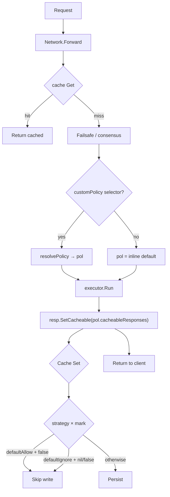
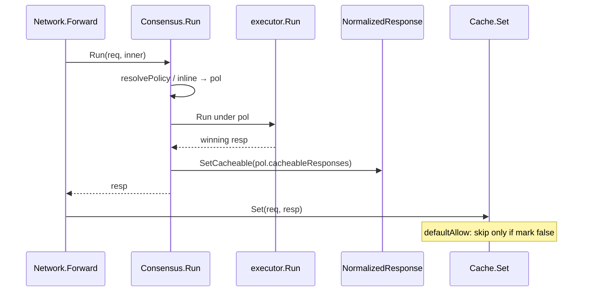
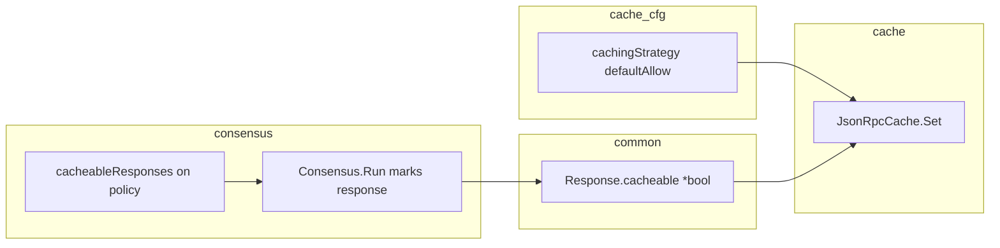

# Response-mark cache admission (consensus) — Specification

**Status**: Proposal
**Direction**: [@aramalipoor](https://github.com/erpc/erpc/pull/1387#discussion_r4443850931) — cache stays consensus-ignorant; mark on response
**Base**: `main`
**Last revised**: 2026-11-02

Companion: [plan.md](./plan.md) (delivery).

> Cache hits are served with zero validation. Cache keys omit policy+auth. A
> weaker consensus grade must not poison TTL for a later caller. Do not teach
> the cache about consensus policy names.

---

## TLDR

The cache has a default write strategy. Modules (consensus in v1) mark the
**winning response** cacheable or not. Circle’s posture: **`defaultAllow`**, and
set `cacheableResponses: false` on weaker grades like `fallback`.

- **`cachingStrategy` on the cache block:** `defaultAllow` | `defaultIgnore`
  (omit → **`defaultAllow`**).
- **`cacheableResponses` on each consensus policy** (inline default + named).
- **Omit defaults for the policy bool:** inline / fail-closed `default` → `true`;
  named policies → `false`.
- **Mark in `Consensus.Run`** after the round, on the response (not the request).
- **Cache Set** combines strategy + mark (see §3).
- **Scope v1:** consensus only (multi-module AND later).

---

## 1. Purpose

Response-level cache admission. The cache stays generic: it only knows a
strategy and a mark on the response. Consensus (and later integrity) decide the
mark without leaking policy names into the cache.

### Goals

- Cache has no consensus types or policy-name knowledge.
- Operators control the default write posture (`defaultAllow` vs `defaultIgnore`).
- Operators control cacheability per consensus grade.
- Selector-enabled networks can cache trusted grades.
- Existing users who omit `cachingStrategy` keep today’s open write posture
  (`defaultAllow`).

### Non-goals

- Integrity (or other modules) voting on the mark in v1.
- Encoding policy names into cache keys / multiplexing under selector.

---

## 2. Config surface

### 2.1 Cache (`CacheConfig` under `evmJsonRpcCache` / `svmJsonRpcCache`)

| Field | Type | Omit default |
|---|---|---|
| `cachingStrategy` | `defaultAllow` \| `defaultIgnore` | **`defaultAllow`** |

```yaml
database:
  evmJsonRpcCache:
    cachingStrategy: defaultAllow   # omit also defaultAllow
    # connectors / policies ...
```

- **`defaultAllow`** — write unless a module marks the response uncacheable
  (`false`). Unmarked (`nil`) responses are written.
- **`defaultIgnore`** — write only when a module marks the response cacheable
  (`true`). Unmarked responses are skipped.

### 2.2 Consensus (`ConsensusPolicyConfig`)

| Field | Type | Omit default |
|---|---|---|
| `cacheableResponses` | `*bool` | inline/`default` → `true`; named `policies.*` → `false` |

```yaml
failsafe:
  - consensus:
      cacheableResponses: true   # omit also true on inline default
      customPolicy:
        evalFunction: |
          (ctx) => { /* ... */ return "default" /* or "fallback" */ }
      policies:
        fallback:
          extends: default
          requiredParticipants: []
          cacheableResponses: false  # omit also false — Circle posture
```

**Circle / typical selector setup:** leave cache at `defaultAllow`; set
`cacheableResponses: false` on `fallback` (and any other weaker named grade).

---

## 3. Behavior

| Step | Rule |
|---|---|
| `Consensus.Run` | After `ex.Run`, `resp.SetCacheable(pol.CacheableResponses)` |
| Cache Set | See decision table below |
| Cache Get | No consensus knowledge; available whenever a cache is configured |
| Forward | Use cache when `cacheDal` exists (+ existing skip-read directives) |

**Set decision** (strategy × mark):

| `cachingStrategy` | mark `nil` | mark `true` | mark `false` |
|---|---|---|---|
| `defaultAllow` | write | write | **skip** |
| `defaultIgnore` | **skip** | write | **skip** |

When multiple modules vote later: **AND** of explicit marks (any `false` →
uncacheable); modules that did not run cast no vote. v1 only consensus sets the mark.

Today selector-enabled networks skip cache entirely. After this feature, that
skip is removed: admission is write-side via strategy + mark.

---

## 4. Flows







---

## 5. Where the flag is set

**Best place:** `Consensus.Run`, single choke point after `ex.Run` returns the
winning response. Leave `markSelected` (ExecState / header) unchanged.

API shape (aligned with `SetFromCache` / `FromCache`):
- `SetCacheable(*bool)` / `Cacheable() *bool` for the mark
- Effective allow for Set derived from strategy × mark (§3)

---

## 6. Open for later

- Multi-module AND (consensus ∧ integrity ∧ …); absent module = no vote.
- Integrity veto timing vs async cache Set.
- Optional read-side mark checks (not required if Set is strict).
