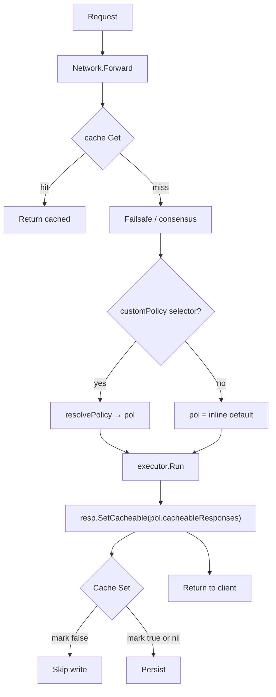
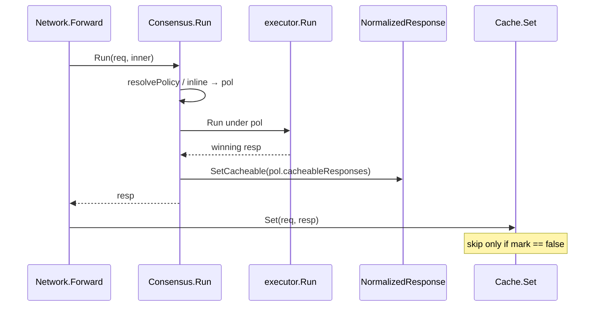
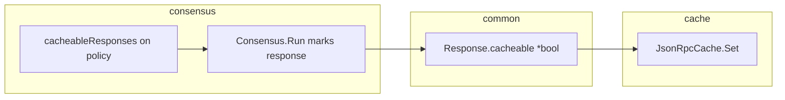

# Response-mark cache admission (consensus) — Specification

**Status**: Proposal
**Direction**: [@aramalipoor](https://github.com/erpc/erpc/pull/1387#discussion_r4443850931) — cache stays consensus-ignorant; mark on response
**Base**: `main`
**Last revised**: 2026-11-02

Companion: [plan.md](./plan.md) (delivery).

> Cache hits are served with zero validation. Cache keys omit policy+auth. A
> weaker consensus grade must not poison TTL for a later caller. Do not teach
> the cache about consensus policy names.

---

## TLDR

Consensus marks the **winning response** as cacheable or not from a per-policy
bool. The cache only reads that mark. Selector networks use Get/Set normally;
writes from non-cacheable grades are skipped.

- **`cacheableResponses` on each consensus policy** (inline default + named).
- **Omit defaults:** inline / fail-closed `default` → `true`; named policies → `false`.
- **Mark in `Consensus.Run`** after the round, on the response (not the request).
- **Cache Set** skips when mark is `false`; `nil` (never through consensus) caches as today.
- **Scope v1:** consensus only (multi-module AND later).

---

## 1. Purpose

Response-level cache admission owned by consensus. The cache component stays
generic: it only honors a mark on the response.

### Goals

- Cache has no consensus types or policy-name knowledge.
- Operators control cacheability per consensus grade.
- Selector-enabled networks can cache trusted grades.
- Zero behavior change for traffic that never runs consensus (`nil` mark → still cache).

### Non-goals

- Integrity (or other modules) voting on the mark in v1.
- Encoding policy names into cache keys / multiplexing under selector.

---

## 2. Config surface

On `ConsensusPolicyConfig`:

| Field | Type | Omit default |
|---|---|---|
| `cacheableResponses` | `*bool` | inline/`default` → `true`; named `policies.*` → `false` |

```yaml
failsafe:
  - consensus:
      cacheableResponses: true   # omit also true on inline default
      customPolicy:
        evalFunction: |
          (ctx) => { /* ... */ return "default" /* or "fallback" */ }
      policies:
        fallback:
          extends: default
          requiredParticipants: []
          cacheableResponses: false  # omit also false
```

---

## 3. Behavior

| Step | Rule |
|---|---|
| `Consensus.Run` | After `ex.Run`, `resp.SetCacheable(pol.CacheableResponses)` |
| Cache Set | Skip if mark == `false`; `nil` → allow |
| Cache Get | No consensus knowledge; available whenever a cache is configured |
| Forward | Use cache when `cacheDal` exists (+ existing skip-read directives) |

Today selector-enabled networks skip cache entirely. After this feature, that
skip is removed: admission is write-side via the response mark.

---

## 4. Flows







---

## 5. Where the flag is set

**Best place:** `Consensus.Run`, single choke point after `ex.Run` returns the
winning response. Leave `markSelected` (ExecState / header) unchanged.

---

## 6. Open for later

- Multi-module AND (consensus ∧ integrity ∧ …); absent module = no vote.
- Optional read-side mark checks (not required if Set is strict).
